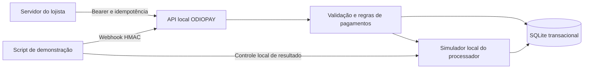

# Arquitetura inicial e decisões

## Objetivo confirmado

ODIOPAY atende negócios próprios e terceiros no Brasil, com Pix e cartão. Receita pretendida: tarifa fixa, percentual e planos com tarifas menores. Internacionalização é uma etapa futura.

Decisão do usuário: manter saldo na experiência ODIOPAY e permitir saque. A versão 0.2 implementa carteira e saque simulados. Custódia, estrutura de contas e execução financeira reais ainda dependem da definição do parceiro e do modelo operacional.

## Estrutura implementada

`src/http.js` recebe e valida a requisição HTTP. `src/security.js` identifica o lojista a partir de uma chave aleatória. `src/payments.js` controla criação, tarifa e confirmação; `src/provider.js` simula o parceiro; `src/database.js` mantém os registros.

Escolha inicial: aplicação única com módulos pequenos. O volume, a equipe e os requisitos de disponibilidade ainda não foram definidos; não há motivo comprovado para distribuir agora as regras financeiras em vários serviços.

Node.js 24 e módulos JavaScript nativos tornam esta primeira entrega reproduzível sem dependências de aplicação. SQLite atende a demonstração persistente em uma máquina. Essa escolha não estabelece SQLite como banco de produção. O desenho de produção deve avaliar PostgreSQL, migrações versionadas, backups, restauração e concorrência sob a carga esperada.

## Invariantes

- Uma chave de idempotência pertence a um lojista e a um conteúdo normalizado.
- O lojista vem da chave autenticada, nunca do corpo da requisição.
- O valor bruto é inteiro, em BRL; tarifa e líquido são calculados no servidor.
- O status somente pode sair de `pending` para `succeeded` ou `failed` nesta versão.
- A confirmação verifica assinatura, valor, moeda, método, lojista, IDs e estado no simulador.
- Cada pagamento bem-sucedido gera um conjunto único de lançamentos com soma zero.
- Recebimento confirmado não significa dinheiro liquidado ou disponível para saque.
- A carteira simulada não mantém recursos reais e não autoriza repasses externos.
- A liquidação credita o valor líquido uma única vez; confirmação isolada não libera saque.
- Cada solicitação de saque reserva saldo dentro da mesma transação que verifica a disponibilidade.
- Resultado incerto mantém a reserva; apenas falha definitiva a libera.

## Integração real: desenho necessário

O simulador compartilha a transação SQLite, o que é possível porque tudo é local. Um processador remoto não compartilha essa transação. Antes de conectar um parceiro real:

1. Persistir a intenção da cobrança e uma tarefa em uma outbox na mesma transação.
2. Um worker envia ao parceiro com chave de idempotência estável e timeout.
3. Gravar o identificador retornado; em respostas incertas, consultar antes de repetir.
4. Receber webhooks com o formato e a verificação oficiais do parceiro.
5. Consultar o parceiro fora da transação; aplicar o resultado com controle de concorrência e trilha auditável.
6. Conciliar periodicamente cobranças, liquidações, taxas e repasses.
7. Tratar estornos, contestações e eventos fora de ordem como estados próprios.

Dados de cartão devem seguir para o checkout/SDK de tokenização do parceiro escolhido. O servidor ODIOPAY deve trabalhar com referências opacas e verificar a vinculação ao lojista, valor e operação. O simulador não prova a segurança de uma integração futura.

## Sequência de entregas

| Etapa | Resultado verificável |
| --- | --- |
| 1 — realizada | API sandbox, carteira, saques simulados, persistência e testes de abuso |
| 2 | Definir parceiro para custódia e saques; documentar custos e contratos da integração |
| 3 | Adaptador do sandbox real do parceiro, checkout/tokenização, outbox e conciliação |
| 4 | Cadastro e autenticação de clientes, permissões, MFA e painel |
| 5 | Planos, cobrança de mensalidades, estornos, contestações e relatórios |
| 6 | Operação controlada: observabilidade, recuperação, carga, revisão independente e requisitos aplicáveis validados |

As etapas 2 e 6 exigem decisões de operação e avaliações específicas; este documento não determina enquadramento regulatório nem certificação.

## Decisões pendentes

- Instituição responsável pela custódia, estrutura de contas e responsabilidade por saques.
- Pessoa física, pessoa jurídica ou ambas no lançamento.
- Parceiro habilitado para o modelo comercial pretendido.
- Tarifas reais, plano mensal, limite por transação e política de risco.
- Hospedagem, volume esperado, disponibilidade e retenção de dados.
